# Отчёт: этап 2 — арена с графикой

Ветка `stage-2/arena`. Вопрос этапа: «понятно ли за полсекунды, что происходит на экране, и приятно ли управлять героем?»

Короткий ответ: **в целом да**. Остановку времени видно сразу: мир становится сепией, а герои «вне времени» остаются цветными. Застывшие ножи висят с золотым ореолом. Сломанные ноги и кровь видны. Плохо читаются мелкие вещи: ножи в полёте, герои в одной точке, длинный журнал. Подробно — в разделе 5.

Как играть:

```bash
pnpm install
```

```bash
pnpm dev
```

Откройте в браузере адрес, который напишет команда (обычно http://localhost:5173).

## 1. Что сделано

### Игра в браузере (`apps/client`)

- **Экран выбора** — три героя своей команды и герой-враг, с карточками героев (лор, метки, слабости, цена силы). [select.ts](../../../apps/client/src/ui/select.ts)
- **Арена** целиком на экране: озеро, пруд, трава, лес, камни, каменистый пол и по трону на каждом краю. Враг стоит у своего трона и ничего не делает. [arena.ts](../../../packages/content/src/arena.ts)
- **Управление** по [10-controls.md](../../10-controls.md): ПКМ — идти или атаковать врага (бьёт, пока тот жив), Q/W/E/R — закон, потом ЛКМ — куда (законы времени срабатывают сразу), Shift — дописать в план, держать Tab — метки под курсором, 1/2/3 — переключение между своими героями, Esc — отменить прицел, пробел — пауза.
- **Цикл игры**: мир тикает ровно 30 раз в секунду, а картинка плавно рисуется между тиками. [loop.ts](../../../apps/client/src/game/loop.ts)
- **Время на экране**: замедленное тускнеет, остановленное серое; во время подготовки закона времени по всей карте бегут золотые кольца, арена дрожит, сверху надпись; застывшие ножи — с золотым ореолом; над остановленным, по которому били, написано, сколько урона его ждёт. [time.ts](../../../apps/client/src/view/time.ts), [entities.ts](../../../apps/client/src/view/entities.ts)
- **Цвета уровней** из [10-controls.md](../../10-controls.md): плоть — красные брызги, механика — белые волны и взмахи, время — золотая рябь. [palette.ts](../../../apps/client/src/view/palette.ts), [effects.ts](../../../apps/client/src/view/effects.ts)
- **Панель героя**: бумажная кукла (4 зоны), здоровье, лорный ресурс, температура, влажность, раны, ход часов; кнопки законов с перезарядкой и причиной, почему нельзя («руки сломаны», «мало Хроноса»); план героя списком. [hud.ts](../../../apps/client/src/ui/hud.ts)
- **Подсказка «не подействует»**: при прицеливании на сущность без нужных меток курсор красный и перечёркнутый, рядом надпись, например «нет метки «Кровь»». [targeting.ts](../../../apps/client/src/game/targeting.ts)
- **Журнал** по-русски справа — тот же, что в `pnpm sim`. Его тексты вынесены в общий пакет [`packages/journal`](../../../packages/journal/src/format.ts).
- **Экран победы и поражения**. [end.ts](../../../apps/client/src/ui/end.ts)

### Ядро и содержимое

- **Команды** — служебное поле `team`. Законы его не читают: это проверяет отдельный тест. [entity.ts](../../../packages/core/src/entity.ts), [lore-honesty.test.ts](../../../test/lore-honesty.test.ts)
- **Условия победы** — общий механизм в ядре; условие «трон уничтожен» — в содержимом. [victory.ts](../../../packages/core/src/victory.ts), [throne.ts](../../../packages/content/src/throne.ts)
- **Трон** с метками из задания и здоровьем 600. [throne.ts](../../../packages/content/src/throne.ts)
- **Законы**: [Остановка времени](../../../packages/content/src/laws/timeStop.ts) (у Хрониста сразу, помечено «временно»), [Перелом](../../../packages/content/src/laws/fracture.ts), [Кровотечение](../../../packages/content/src/laws/bleeding.ts). Кровь течёт при ходьбе (стоя — меньше) и оставляет след на клетках на 60 с.
- **Первое настоящее особое взаимодействие** — «Пламя + Кровотечение = прижигание». [interactions.ts](../../../packages/content/src/interactions.ts). Ядро даёт только место для таких взаимодействий и не знает ни одного. [interaction.ts](../../../packages/core/src/interaction.ts)
- **Герои** по шаблону из 07: [Хронист](../../../packages/content/src/heroes/chronist.ts) (хрупкое тело, «Хронос» стоя копится быстрее), [Тень-без-часов](../../../packages/content/src/heroes/shadow.ts), [Мясник](../../../packages/content/src/heroes/butcher.ts) (регенерация).
- В ядре: раны и кровавый след, регенерация, хрупкость тела, обход деревьев и камней при ходьбе, «атаковать, пока цель жива» и «подойти и применить».
- Новый сценарий без графики: `pnpm sim arena-knife-wall` — «стена ножей» настоящими законами.

**Тесты: 199, все зелёные** (на этапе 1 было 96). Каждый новый закон — на кого действует, на кого нет, бьёт ли своих и носителя. Прижигание, «Перелом + Кровотечение», трон, условия победы, герои, целый матч «убить врага → сломать трон → победа» без графики, и логика клиента: цикл, команды, подсказка «не подействует», цвета, камера.

## 2. Как проверить

```bash
pnpm install
```

```bash
pnpm check
```

Должно закончиться строками `Tests  199 passed (199)` и `✓ built`.

```bash
pnpm dev
```

Дальше в браузере:

1. **Победа.** «В бой» → нажать `1`, ПКМ по розовому «М» справа; то же для `2` и `3`. Когда враг погибнет — ПКМ по розовому трону всеми тремя. Через полминуты — «Победа!».
2. **Стена ножей.** `1` → `Q` (замедление). `2` → ПКМ, отойти от врага подальше, `Q` и ЛКМ по врагу, отбежать в сторону. Пока время ещё замедлено, `1` → `R` (остановка). Тенью (`2`) бросить ещё нож. Ножи висят с золотым ореолом, потом летят разом. Без прокачки ножей получится два-три (см. «Что заметил»).
3. **Сломанные ноги и кровь.** Выбрать врагом Тень-без-часов или Хрониста (у врага-Мясника регенерация). Мясником (`Q`) бить, наведя курсор чуть ниже центра врага — подсказка покажет «по зоне «ноги»». Потом `W` (кровотечение) и `E` (импульс) — раненого отбросит, по пути останутся капли крови.

Без графики:

```bash
pnpm sim arena-knife-wall
```

Хронист замедляет, потом останавливает время; три ножа висят и потом все три попадают во врага.

## 3. Скриншоты

Сделаны в облачном браузере настоящими кликами и клавишами. Надпись «ПАУЗА» сверху — это я ставил игру на паузу, чтобы снять нужный миг.

**Экран выбора**

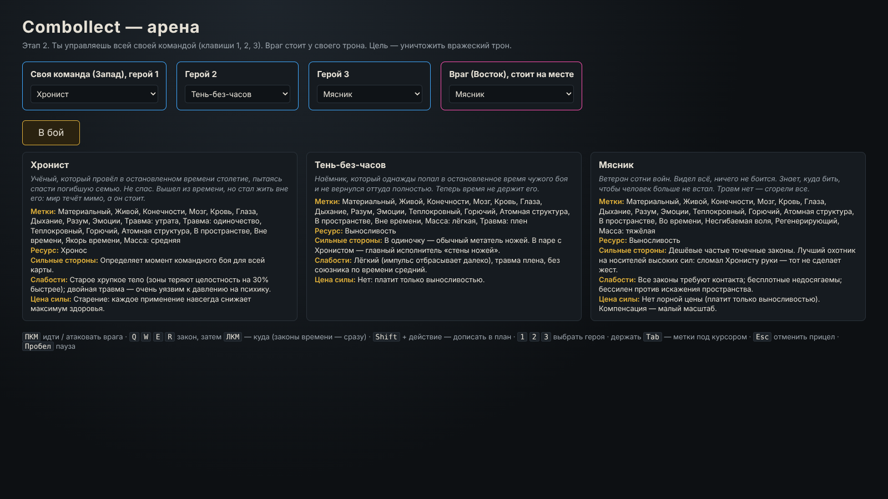

**Арена в начале матча.** Слева свои (синие кольца) и свой трон, справа враг (розовое кольцо) у своего трона.

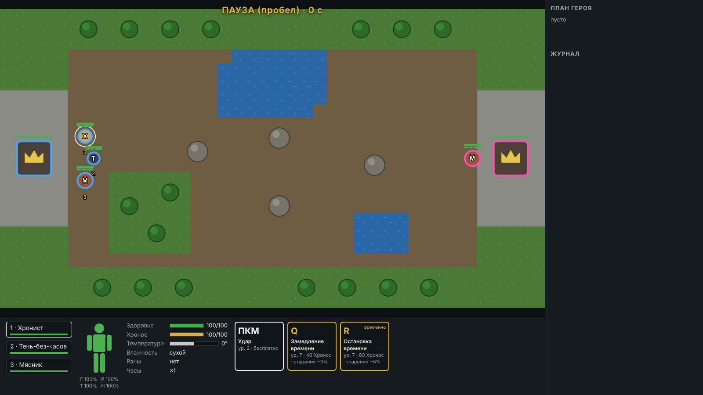

**Подготовка Остановки времени.** Время уже замедлено (мир тусклый, «⧗×0.25»), Хронист готовит остановку: по карте идут золотые кольца, арена в золотой рамке, сверху «Готовится закон времени».

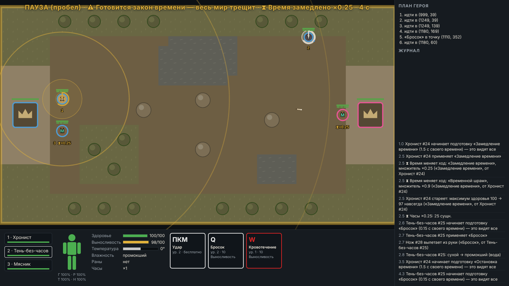

**Стена ножей.** Время стоит: мир — сепия, Хронист и Тень (вне времени) цветные. Три ножа висят с золотым ореолом: два застыли в полёте у врага, третий — у руки Тени.

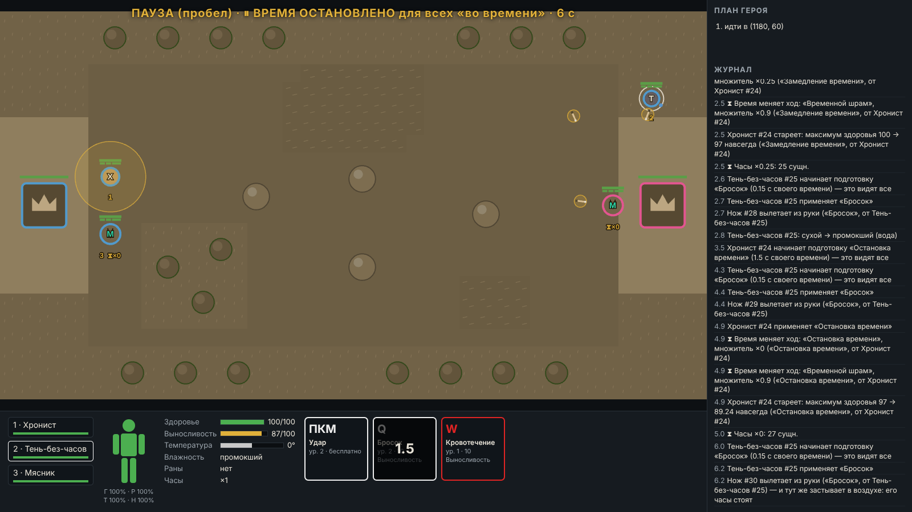

**Время пошло.** Ножи снова летят (они теперь обычного цвета, без ореола).

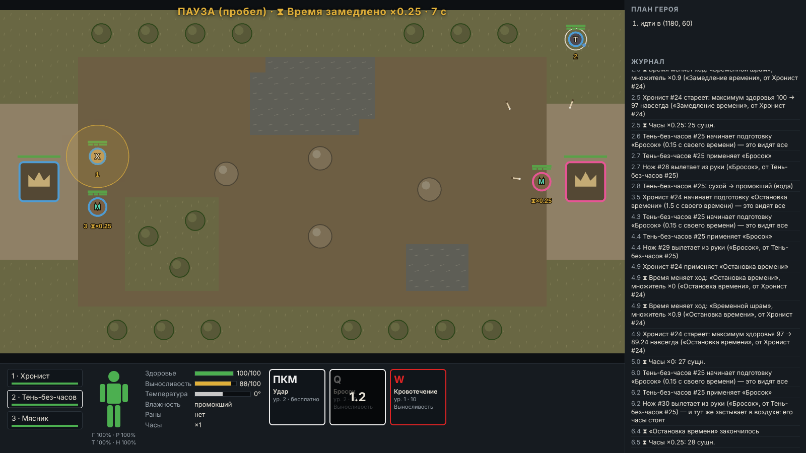

**После стены.** Все три ножа попали: у врага почти −60 здоровья (три ножа по 20, регенерация чуть вернула).

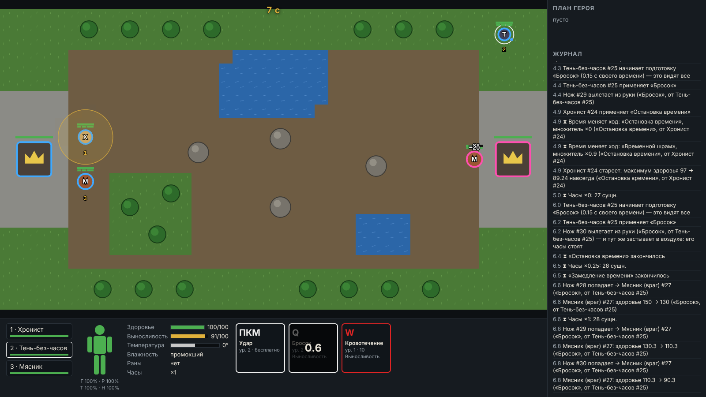

**Удар по остановленному.** Тень бьёт остановленного врага: удар записан и ждёт — над врагом «10 урона ждёт».

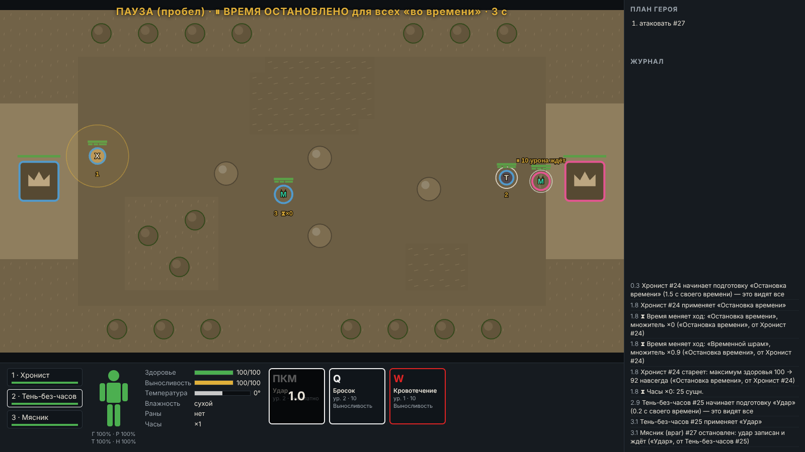

**Прицел Перелома.** Курсор ниже центра врага — подсказка «по зоне «ноги»», цель обведена зелёным.

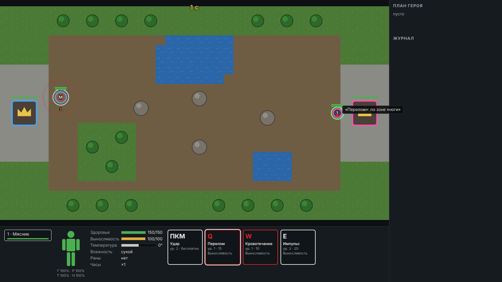

**Ноги сломаны.** Три Перелома — «ноги сломаны!»; у врага на маленькой кукле над головой ноги чёрные.

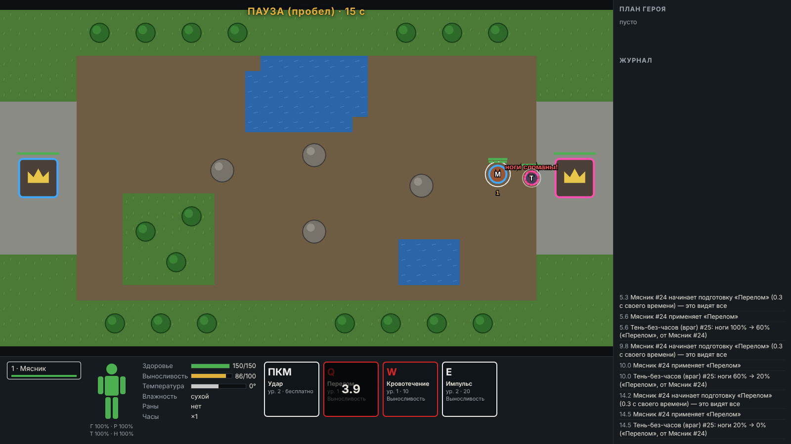

**Кровавый след.** Раненого отбросило Импульсом через поле, по пути — капли крови; он врезался в дерево (−19 обоим). По Tab видны его метки и тело: «ноги 0%», «ран: 2».

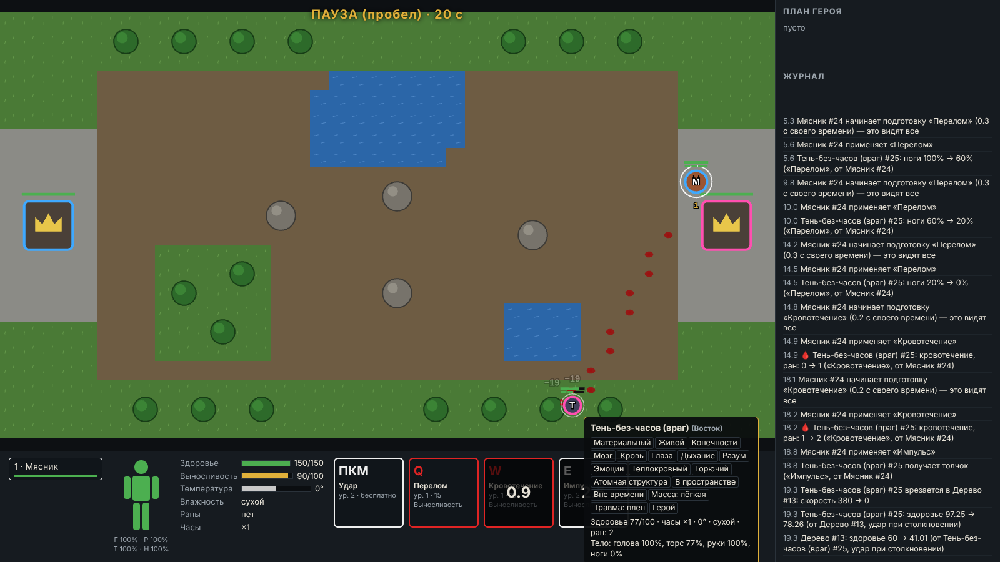

**«Не подействует».** Кровотечение наведено на трон: курсор красный и перечёркнутый, надпись «нет метки «Кровь»».

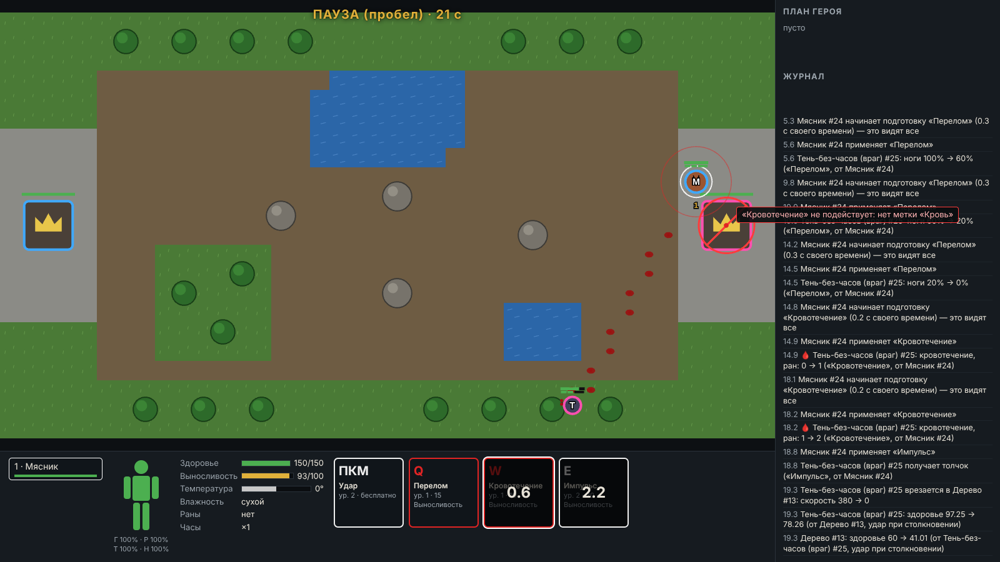

**Победа.**

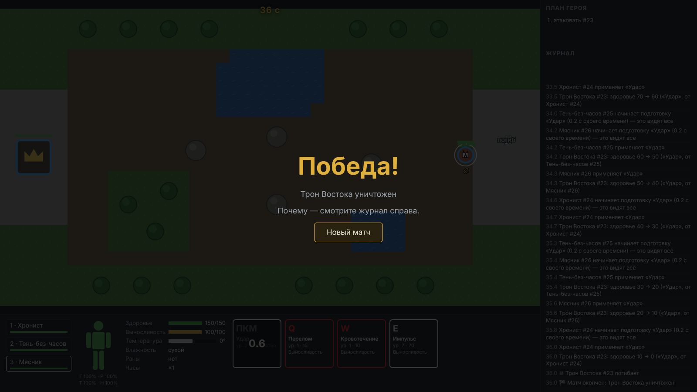

## 4. Что не сделано и почему

- **Бота и сети нет** — это этап 3, по заданию.
- **Герои не возрождаются.** Почему они возрождаются — открытый вопрос лора. Если погибли все свои, проиграть нельзя, только начать новый матч ([decisions.md](../decisions.md), № 42).
- **Прокачки нет**, поэтому Остановка времени дана Хронисту сразу (помечено «временно» в коде и на кнопке), а «стена ножей» — из одиночных ножей.
- **Звука нет** — вне этапа.
- **Кровотечение только ударом**, не снарядом: в каталоге «снаряд или удар», выбран удар (№ 36).
- Тела по-прежнему не толкают друг друга при ходьбе (это было и на этапе 1).

## 5. Что на экране читается плохо

1. **Ножи мелкие.** В полёте это тонкая чёрточка, в замедлении её легко потерять. В остановке спасает золотой ореол. Нож, застывший у руки, почти закрыт телом Тени.
2. **Герои сливаются.** Тела не толкаются, поэтому трое своих, атакуя одну цель, стоят в одной точке — видно один кружок.
3. **В остановке вся карта одного бурого цвета.** Вода, трава и земля почти неразличимы. Зато герои вне времени выделяются очень ярко — это, наверное, хорошо.
4. **Кровавый след** — тёмно-красные капли на коричневой земле: виден, если знаешь, что искать. При толчке капли редкие, по одной на клетку.
5. **Розовый цвет врага рядом с красным цветом плоти.** Брызги Перелома и Кровотечения на враге сливаются с его кольцом. Свободных ярких цветов почти не осталось: красный — плоть, оранжевый — огонь, золотой — время, фиолетовый — психика.
6. **Свой и вражеский Мясник** — одна и та же буква «М», различаются только цветом кольца.
7. **Журнал многословный и быстро уезжает.** Строки длинные, с номерами «#25»; каждый замах — «это видят все». Удары базовой атаки я из журнала на экране уже убрал, но бой из трёх героев всё равно прокручивает его за пару секунд.
8. **Какую зону бьёт Перелом**, понятно только по подсказке у курсора («по зоне «ноги»»). Без неё «верх» и «низ» тела в виде сверху неочевидны.
9. **Мелкие подписи** — номера героев и «⧗×0.25» под ними; кнопка закона на перезарядке: цифра закрывает название.
10. **Кольца подготовки времени** бледнее на светлой траве, чем на земле. Золотая рамка вокруг арены и надпись сверху помогают.

## 6. Допущения

Все — в [decisions.md](../decisions.md), записи 25–45. Самые важные:

- **№ 37 — прижигание.** Прижигает Пламя, если оно действительно нагрело тело, или если тело загорелось. Мокрую рану Пламя не прижигает: тепло уходит на высыхание. Горящая трава под ногами не прижигает.
- **№ 36 — кровотечение.** Рана не проходит сама: её закрывает прижигание или регенерация. Кровь течёт при ходьбе ногами; если раненого отбросило — как стоя.
- **№ 35 — перелом.** Зона выбирается курсором: выше центра цели — руки, ниже — ноги.
- **№ 39 — хрупкость Хрониста** ×1.3 ко всем зонам, включая торс: два Перелома ломают ему руки, и он не может применить законы времени.
- **№ 40 — регенерация Мясника**: 1% зон и здоровья в секунду, одна рана затягивается за 10 с.
- **№ 34 — числа Остановки времени**: подготовка 1.5 с, перезарядка 90 с, «Хронос» 60.
- **№ 33 — трон**: 600 здоровья, не сдвигается, на него честно действуют законы (стоит в остановке, бьётся Ударом, даже своим).
- **№ 44 — ПКМ** атакует только чужих; по своим ПКМ — «идти» (закон при этом своих бьёт — через Q/W).
- № 41 — числа героев; № 42 — без возрождения.

## 7. Что заметил

1. **Без прокачки «стена ножей» — это два-три ножа, и только с замедлением.** Остановка длится 1.5 с, а перезарядка броска — 1.5 с: в одной остановке успеваешь бросить один нож. Стена получается так: в замедлении бросить ножи издалека (они ползут), потом остановить время, пока они ещё в полёте. Выглядит красиво, но требует точного тайминга от двух героев.
2. **Свой нож в замедлении опасен для Тени.** Нож ползёт вчетверо медленнее, и Тень, сделав шаг вперёд после броска, налетает на него сама (−20). Это честно, но, похоже, станет частой обидной ошибкой.
3. **План пропускает бросок на перезарядке.** Если Тень дошла до точки раньше, чем закон перезарядился, бросок пропускается (так в [06-time-system.md](../../06-time-system.md), правило 4). Для стены ножей приходится прокладывать путь подлиннее.
4. **Кровотечение против стоящего слабое, против бегущего — очень сильное.** Стоя — 0.5 здоровья в секунду на рану, на бегу — около 6. Неподвижный враг почти не страдает и не оставляет следа. Чтобы увидеть след на неподвижном враге, его надо сдвинуть (Импульсом) — или порезать своего и провести его: закон бьёт и своих.
5. **Регенерация Мясника почти отменяет Перелом и Кровотечение против него**: рана закрывается за 10 с, Перелом ног −40% заживает за 40 с. Мясник против Мясника — долгий бой.
6. **Импульс по лёгкой Тени отбрасывает её на 400 единиц** — через треть карты; удар о дерево — −19 обоим.
7. **Импульс сдвигал трон, камни и деревья**, хотя по допущению № 14 они «вросли в землю». Нашёл глазами на арене (трон уехал на 50 единиц), исправил и добавил тест.
8. **Остановка времени останавливает и троны, и деревья** — в журнале «Часы ×0: 27 сущн.» — всё, что во времени. Удар по остановленному трону копится — честно по правилу 2 из 06.
9. **Одна комбинация «Замедление + Остановка» стоит Хронисту 11% здоровья навсегда** (−3% и −8%) и весь «Хронос» (40 + 60 = 100). Второй раз за матч он её сделает нескоро: «Хронос» стоя копится 50 с.
10. **Первое особое взаимодействие встало без единой правки законов**: прижигание реагирует на события мира («тело нагрелось от Пламени», «тело загорелось»). Это хороший знак для будущих особых взаимодействий.

Новые открытые вопросы (направление Перелома, прижигание огнём снизу, скорость регенерации, проходит ли рана сама, свой нож в замедлении, перезарядка в плане, толкание тел) добавлены в [../../13-open-questions.md](../../13-open-questions.md), раздел «Найдено на этапе 2».

## 8. Что предлагаю дальше

1. Ответить на открытые вопросы этапа 2 — особенно про **перезарядку в плане** (пункт 3 выше) и **регенерацию**: от них зависит, как ощущаются стена ножей и Мясник.
2. Поиграть самому 10–15 минут и отметить, что ещё сливается: я смотрел только на скриншоты.
3. Небольшие правки читаемости до этапа 3: тела, которые не стоят друг в друге; ножи чуть заметнее в полёте; разные буквы или формы для своего и вражеского героя; короче строки журнала.
4. После этого — этап 3: сервер и игра с другом.
